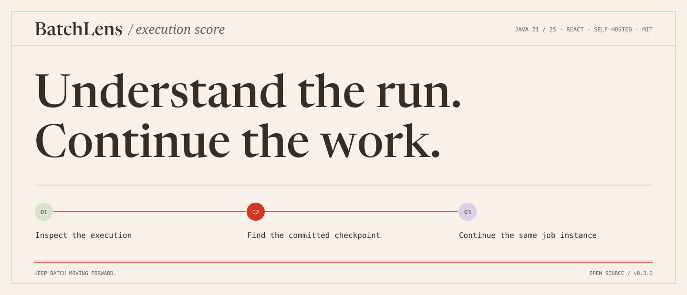
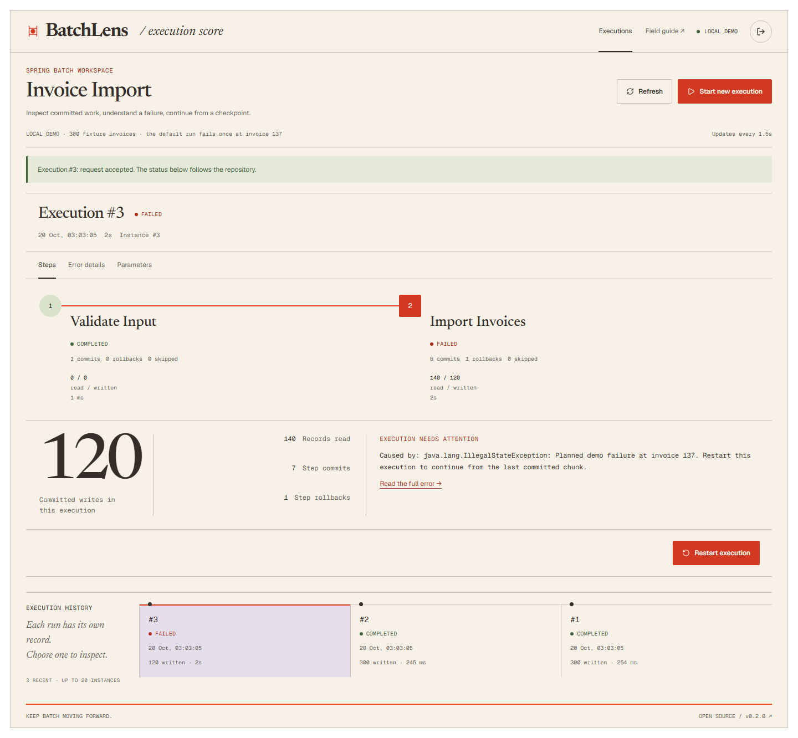

<p align="center"></p>

[](https://github.com/lMysticl/batchlens/actions/workflows/ci.yml)

`JAVA 21 / 25`　`REACT + TYPESCRIPT`　`SELF-HOSTED`　`MIT`

**A React operations console inside your Spring Batch application.** Inspect a
failed step, understand what committed, and restart the right execution from its
checkpoint. Your `JobRepository` remains the source of truth.

[Try the release](https://github.com/lMysticl/batchlens/releases/latest) ·
[Usage](docs/usage.md) · [Architecture](docs/architecture.md) ·
[Validation](docs/validation.md) · [Engineering brief](docs/project-brief.md) · [Design notes](docs/design.md) · [Technical walkthrough](docs/article.md)



*The bundled demo processes 300 synthetic invoices, fails once at invoice 137,
and resumes from a real committed chunk. This is an application capture.*

## Try it in a minute

Download `batchlens-demo-0.2.0.jar` from the [release](https://github.com/lMysticl/batchlens/releases/tag/v0.2.0).
Run it with Java 21 or 25:

```sh
java -jar batchlens-demo-0.2.0.jar
```

Open **http://localhost:8091/batchlens/**. Use **Use the bundled local demo token**,
then **Connect workspace**. Start an execution with the suggested parameters.
When it fails, inspect the step, then choose **Restart execution**. The import
finishes with 300 unique rows. H2 metadata lives in `./data/`.

The demo token is a public fixture. Use your own `BATCHLENS_API_TOKEN` for a real
deployment and review the [security notes](SECURITY.md).

## What you get

| Operator task | BatchLens behavior |
|---|---|
| Find a failed job | Registered jobs plus persisted execution history |
| Understand committed work | Real read/write/skip/commit/rollback counts per step |
| Diagnose a failure | Full escaped error detail and identifying parameters |
| Continue a failed import | Restart a FAILED or STOPPED execution through `JobOperator` |
| Stop a long import | Cooperative stop with the current repository status |
| Avoid stale commands | Explicit conflict responses and automatic metadata refresh |

The starter is opt-in. Operations are disabled by default. It adds no scheduler,
does not edit Batch tables directly, and does not substitute browser state for
execution state. The UI uses cancellable, serial polling.

## Add it to an application

v0.2.0 targets **Spring Boot 4.1.1 / Spring Batch 6.0.5**. Build and install the
starter locally from source; this release is distributed through GitHub, not
Maven Central.

```sh
git clone https://github.com/lMysticl/batchlens.git
cd batchlens/ui
npm ci
npm run build
cd ..
./mvnw -B install
```

On Windows, use `mvnw.cmd`. Add `io.github.lmysticl:batchlens-spring-boot-starter:0.2.0`
to your Spring Boot application, then configure:

```properties
batchlens.enabled=true
batchlens.api-token=${BATCHLENS_API_TOKEN}
batchlens.operations-enabled=false
```

For job control, register your `Job` beans, enable operations and provide an
asynchronous, bounded `@BatchTaskExecutor`. The starter respects the host's
`JobOperator` and execution model. The [integration guide](docs/usage.md#host-application)
includes the exact dependency and executor example.

## Build and verify

JDK 21 or 25 and Node 24.15+ / 24.x are required to build the frontend.

```sh
cd ui
npm ci
npm run check
npm test
npm run build
cd ..
./mvnw -B verify
```

CI checks Java 21/25 on Ubuntu and Windows. Integration tests use actual HTTP,
Spring Batch metadata and transactional chunk recovery. See the
[test map](docs/validation.md) and [compatibility contract](docs/compatibility.md).

## Deliberate scope

This release operates inside one application instance. It shows recent
history, supports string identifying parameters, and exposes the host's registered
jobs. It does not remotely schedule jobs, repair arbitrary metadata, automatically
recover jobs stranded by a process crash, or provide multi-user authorization.
Those boundaries are described in [usage](docs/usage.md).

Built by [Pavel Putrenkov](https://github.com/lMysticl). Contributions and useful
reproductions are welcome. Original project code is [MIT licensed](LICENSE).
