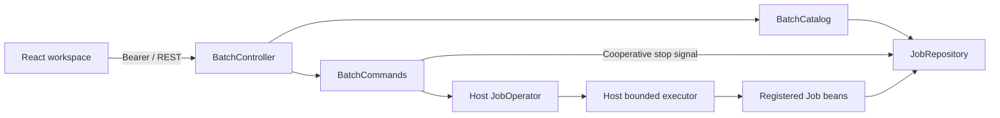

# Architecture

`batchlens-spring-boot-starter` packages opt-in auto-configuration, REST handlers
and the production React assets. `batchlens-demo` consumes that starter as a
normal Maven dependency and owns the invoice job, datasource, executor and fixtures.
The starter contains no demo business logic.

`catalog` projects Spring Batch objects into immutable DTO records. All reads
come from `JobRepository`, including step errors and checkpoint-related counts.
Missing JDBC metadata is translated into a stable 404 at the adapter boundary.

`operations` validates commands, enforces the read-only switch and delegates
start/restart to `JobOperator`. Stop sets STOPPING through the public repository API;
the worker owns step completion and checkpoint writes. The [stop decision](decisions/0001-cooperative-stop.md)
records the qualified Spring Batch 6.0.5 behavior. A fixed array of 32 locks bounds lock storage
and serializes commands for the same execution. Spring Batch owns transaction
and job-instance consistency; no custom SQL updates its metadata.

`web` owns URL mapping, authentication and Problem Details. Authentication checks
the resolved controller, so encoded or matrix path variants cannot bypass a raw
path-prefix filter. Static assets remain public; API responses are `no-store`.
The host's existing security chain remains in effect.

The React workspace owns selection and transient forms. Each selected execution
has its own detail request; it remains inspectable after it leaves the recent
list. Serial polling aborts on selection change/unmount and ignores stale
responses. Commands are followed by repository refresh, not optimistic completion.

The demo's CSV reader saves its state at chunk boundaries. The writer inserts
with a `(run_key, invoice_id)` primary key. The first attempt intentionally fails
after some committed chunks; the restart is a second execution of the same
instance. Reconciliation checks exactly 300 rows.

No scheduler, message bus, Redux layer, generic repository framework or custom
metadata schema is needed for this scope. See [compatibility](compatibility.md)
for the tested versions and [usage](usage.md) for recovery limits.
