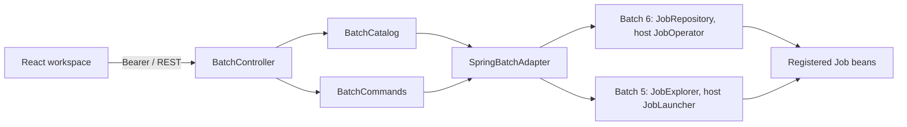

# Architecture

| Module | Owns |
|---|---|
| `batchlens-core` | The React assets, REST handlers, authentication, Problem Details and the command rules. Compiled against Spring Boot 3.5; the host application supplies Spring at runtime. |
| `batchlens-spring-boot-starter` | Opt-in auto-configuration and the Spring Batch 6.0 adapter. |
| `batchlens-spring-boot3-starter` | Opt-in auto-configuration and the Spring Batch 5.2 adapter. |
| `batchlens-demo` | The invoice job, datasource, executor and fixtures. It uses the Boot 4 starter as a normal dependency. |

`SpringBatchAdapter` is the only seam between the core and Spring Batch. Its
implementations are the calls whose types moved between Spring Batch 5 and 6:
reading executions, projecting them into views, launching, restarting and saving a
stop request. Their projection code reads alike but compiles against different
packages, so each starter keeps its own copy. The starters contain no demo business
logic.

`catalog` lists jobs and history from immutable view records. All reads come from
the job repository, including step errors and checkpoint-related counts. Missing
JDBC metadata is translated into a stable 404 at the adapter boundary.

`operations` validates commands, enforces the read-only switch and the restart and
stop preconditions, then delegates to the adapter: Batch 6 starts and restarts through
`JobOperator`; Batch 5 launches again with the same identifying parameters through
`JobLauncher`. Stop sets STOPPING through the public repository API;
the worker owns step completion and checkpoint writes. The [stop decision](decisions/0001-cooperative-stop.md)
records the qualified Spring Batch 6.0.5 behavior. A fixed array of 32 locks bounds lock storage
and serializes commands for the same execution. Spring Batch owns transaction
and job-instance consistency; no custom SQL updates its metadata.

`web` owns URL mapping, authentication and Problem Details. Authentication checks
the resolved controller, so encoded or matrix path variants cannot bypass a raw
path-prefix filter. Static assets remain public; API responses are `no-store`.
The host's existing security chain remains in effect.

The React workspace owns selection and transient forms. Each selected execution
has its own detail request; it remains inspectable after it leaves the recent
list. Serial polling aborts on selection change/unmount and ignores stale
responses. Commands are followed by repository refresh, not optimistic completion.

The demo's CSV reader saves its state at chunk boundaries. The writer inserts
with a `(run_key, invoice_id)` primary key. The first attempt intentionally fails
after some committed chunks; the restart is a second execution of the same
instance. Reconciliation checks exactly 300 rows.

No scheduler, message bus, Redux layer, generic repository framework or custom
metadata schema is needed for this scope. See [compatibility](compatibility.md)
for the tested versions and [usage](usage.md) for recovery limits.
